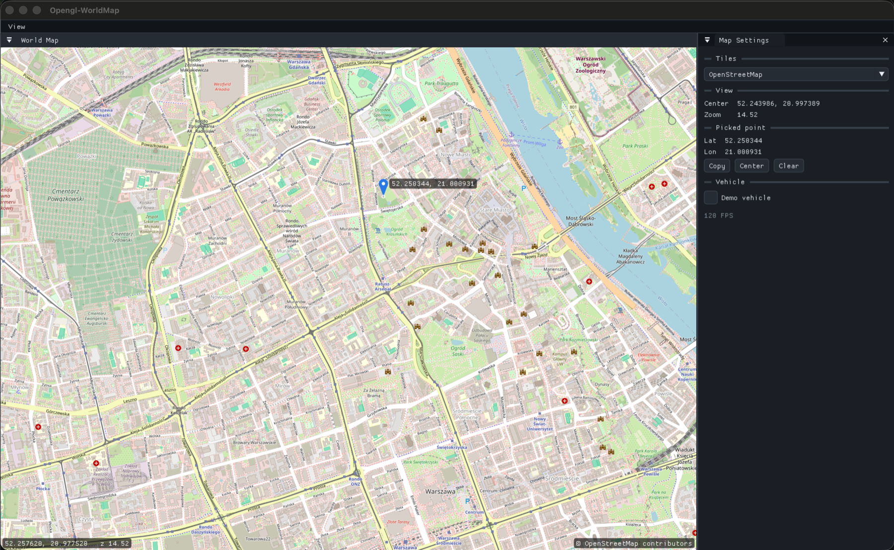

# Opengl-WorldMap

A ground-station style world map built with **OpenGL**, **GLFW**, **GLAD** and **Dear ImGui**.
It streams slippy-map tiles (OpenStreetMap or satellite imagery), lets you pan, zoom and pick
coordinates, and shows a vehicle marker — the starting point for a QGroundControl-like app in C++.



## Features

- **Interactive world map**: drag to pan, mouse wheel to zoom around the cursor, double-click to zoom in.
- **Tile sources**: OpenStreetMap and Esri World Imagery (satellite), switchable at runtime.
- **Coordinate picking**: click anywhere to drop a pin and read its latitude/longitude (WGS84, 6 decimals).
  Copy it to the clipboard or center the map on it.
- **Live cursor readout**: coordinates under the mouse and current zoom in the corner of the map.
- **Vehicle marker**: heading-aware arrow, ready to be driven by real telemetry (a demo vehicle is included).
- **Background tile loading**: 4 worker threads download with libcurl, decode with stb_image, and upload as
  OpenGL textures. Lower-zoom tiles are stretched in as placeholders, so there are no blank gaps while loading.
- **Disk cache**: every tile viewed once is reused offline.
- **Dockable UI**: every panel can be docked, tabbed, split or floated. *View → Reset Layout* restores the default.
- **Themes**: a custom *Ground Station* dark theme plus ImGui Dark/Light, and a live *Style Editor*.

## Requirements

- CMake 3.12+
- A C++17 compiler
- GLFW 3
- libcurl
- OpenGL 3.2+ (3.3 core on Linux/Windows)

GLAD, Dear ImGui (docking branch, 1.89.6) and stb_image are bundled in [`dependencies/`](dependencies/).

### macOS

```bash
brew install cmake glfw
```

libcurl and OpenGL ship with macOS.

### Linux (Debian/Ubuntu)

```bash
sudo apt install build-essential cmake libglfw3-dev libcurl4-openssl-dev libgl1-mesa-dev
```

## Build and run

```bash
cmake -S . -B build
cmake --build build
./build/Opengl-WorldMap
```

## Usage

| Action | How |
| --- | --- |
| Pan | Drag with the left mouse button |
| Zoom | Mouse wheel (zooms around the cursor) or double-click |
| Pick a coordinate | Click without dragging. The pin and its coordinates appear on the map and in **Map Settings** |
| Copy / center / clear the pick | Buttons under **Picked point** in **Map Settings** |
| Change map tiles | **Map Settings → Tiles** |
| Show a moving vehicle | **Map Settings → Vehicle → Demo vehicle** |
| Change theme | **View → Theme** |
| Tweak colors and sizes live | **View → Style Editor** (use its *Export* button to copy the result as code) |
| Restore the panel layout | **View → Reset Layout** |

## Project structure

```
Opengl-WorldMap/
├── main.cpp              # Window, ImGui setup, dockspace, menus, panels
├── Map/
│   ├── MapWidget.h/.cpp  # Map widget: Web Mercator math, input, tiles, pin, vehicle, overlays
│   └── TileManager.h/.cpp# Threaded tile download (libcurl), disk cache, decode, GL textures
├── Theme/
│   └── Theme.h/.cpp      # Ground Station theme and theme switching
├── dependencies/         # GLAD, Dear ImGui, stb_image
└── docs/screenshot.png
```

## Using the map in your own code

```cpp
#include "Map/MapWidget.h"

// After the OpenGL context and ImGui are initialized:
auto map = std::make_unique<MapWidget>("/path/to/tile/cache");
map->setCenter(52.2297, 21.0122);   // lat, lon
map->setZoom(12.0);

// Every frame, inside any ImGui window:
ImGui::Begin("World Map");
map->draw("##map");                 // fills the remaining content region
ImGui::End();

// Feed it telemetry (e.g. from MAVLink / MAVSDK):
map->setVehicle(lat, lon, headingDeg);

// Read the point the user clicked:
if (map->hasPickedPoint())
    printf("%f, %f\n", map->pickedLat(), map->pickedLon());

// Destroy the map before the GL context (it owns textures):
map.reset();
```

To add another tile provider, add an entry to `kSources` in [`Map/MapWidget.cpp`](Map/MapWidget.cpp)
with a URL template containing `{z}`, `{x}` and `{y}`.

## Offline use

Tiles are cached on disk the first time they are shown:

| OS | Cache location |
| --- | --- |
| macOS | `~/Library/Caches/Opengl-WorldMap/tiles/` |
| Linux | `~/.cache/Opengl-WorldMap/tiles/` |
| Windows | `%LOCALAPPDATA%\Opengl-WorldMap\tiles\` |

Areas and zoom levels you have already viewed work without a network connection. Areas you have not
viewed stay empty. Pre-downloading regions is not implemented yet.

## Tile usage policy

The built-in sources use public tile servers, which are fine for development and light use only:

- **OpenStreetMap**: follow the [Tile Usage Policy](https://operations.osmfoundation.org/policies/tiles/).
  The app sends an identifying User-Agent and shows the required "© OpenStreetMap contributors"
  attribution. Bulk downloading is not allowed.
- **Esri World Imagery**: subject to Esri's terms of use.

For production use, switch to a provider that issues API keys (for example MapTiler or Mapbox) or host your own tiles.

## Roadmap

- [ ] MAVLink / MAVSDK telemetry for the vehicle marker
- [ ] Waypoints and mission path drawing
- [ ] Offline region download and MBTiles support
- [ ] Persist the docking layout between launches
- [ ] Custom font in `assets/fonts/`

## Acknowledgements

- [Dear ImGui](https://github.com/ocornut/imgui) by Omar Cornut
- [GLFW](https://www.glfw.org/) and [GLAD](https://github.com/Dav1dde/glad)
- [stb_image](https://github.com/nothings/stb) by Sean Barrett
- Map data © [OpenStreetMap contributors](https://www.openstreetmap.org/copyright)
